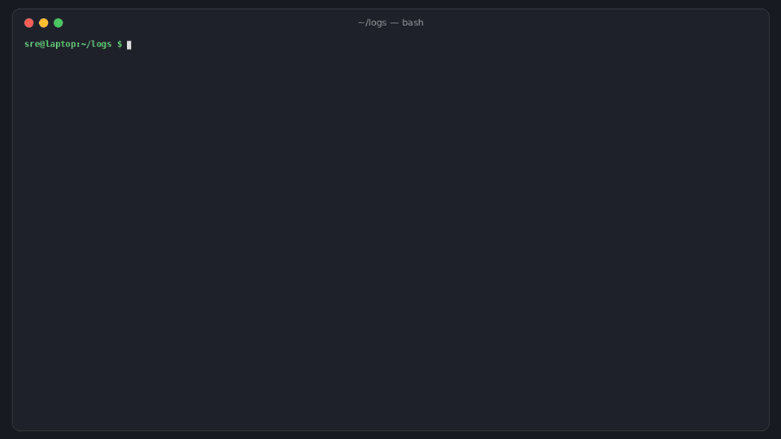

# logspend

[](https://github.com/hamarshehmhmd/logspend/actions/workflows/ci.yml)
[](LICENSE)


**Find the log patterns that drive your observability bill, and get drop/sample rules for the OpenTelemetry Collector, Vector or Fluent Bit that have been run in the real thing.**



```sh
curl -fsSL https://raw.githubusercontent.com/hamarshehmhmd/logspend/main/install.sh | sh
```

## The problem

Log bills grow faster than the product. Datadog charges per GB ingested *and* per million indexed events; CloudWatch, New Relic and Grafana Cloud charge per GB. Most of that money goes on lines nobody reads: kube-probe health checks, debug SQL left on in production, cache hits, heartbeats, 2 KB webhook payloads.

Teams usually find out at renewal ([$83k/year Datadog renewal](https://news.ycombinator.com/item?id=41357726), [$65M bill](https://news.ycombinator.com/item?id=35837330)), then either cut visibility blindly or spend a week hand-writing regexes for their log pipeline and hoping they don't drop the errors they'll need at 3 AM.

`logspend` does that week in a minute, on a log sample you already have:

1. **analyze**: groups lines into templates (`GET /healthz <NUM> <NUM>`), works out what each costs per month at your vendor's prices, and suggests `drop` / `sample` / `keep`.
2. **rules**: turns the plan into config for the **OpenTelemetry Collector** (filter processor, OTTL), **Vector** (remap) or **Fluent Bit** (grep).
3. **simulate**: replays the plan against logs and tells you the savings and whether **any warn/error line** would be lost. Use `--fail-on-dropped-errors` in CI.

It's a single zero-dependency Python CLI. No agent, no SaaS, your logs never leave the machine.

## Install

```sh
curl -fsSL https://raw.githubusercontent.com/hamarshehmhmd/logspend/main/install.sh | sh
```

The script uses `uv tool`, then `pipx`, then a private venv in `~/.local/share/logspend`. Or install directly:

```sh
pipx install git+https://github.com/hamarshehmhmd/logspend
# or: pip install git+https://github.com/hamarshehmhmd/logspend
```

Needs Python 3.10+. Tested on Linux, macOS and Windows.

## Usage

Grab an hour of logs the way you ship them (`kubectl logs`, a file from the node, an S3 export, `docker logs`):

```sh
kubectl logs deploy/api --since=1h --timestamps > api.log
logspend analyze api.log --vendor datadog --scale 40 --plan plan.json
```

```
logspend 0.1.0  23,920 lines, 5.2 MB over 60.0 min (from timestamps)
pricing: Datadog: $0.10/GB ingest + $1.70/M indexed events (15-day, annual) (approximate list price; override with --price-gb), scaled x40
19 patterns, sorted by cost. Projected monthly bill for these sources: $1,186.08

id   bytes%    $/month     lines level  action      template
p1    23.3%     357.32     7,227 INFO   drop        GET /healthz <NUM> <NUM>
p2    14.0%     213.75     4,323 DEBUG  drop        SELECT id, status, total FROM orders WHERE user_id = <NUM> LIMIT <N...
p3     4.6%     117.80     2,392 DEBUG  drop        cache hit key=user:<NUM>
p4    30.3%      75.08     1,441 INFO   sample/10   stripe webhook received
p5     2.2%      47.83       970 INFO   drop        worker heartbeat ok queue=emails depth=<NUM>
p6     1.8%      46.83       951 INFO   keep        user <*> logged in
...
With these suggestions: 5.2 MB -> 1.5 MB in this sample, $1,186.08 -> $381.82/month (-68%)
Warn/error lines and anything that mentions a failure are never dropped or sampled.
```

(That's `examples/app.log`, a generated hour from a small web app; try it yourself.)

`plan.json` is yours to edit: change any pattern's `action` to `keep`, `drop` or `sample` (with `sample_keep: N`). Then:

```sh
logspend simulate plan.json api.log --fail-on-dropped-errors   # savings + safety check
logspend rules plan.json --target otel      > logspend-otel.yaml
logspend rules plan.json --target vector --inputs kubernetes_logs > logspend-vector.toml
logspend rules plan.json --target fluentbit > logspend-fluentbit.conf
```

OpenTelemetry Collector output (add `filter/logspend` to your logs pipeline, or pass the file as an extra `--config`):

```yaml
processors:
  filter/logspend:
    error_mode: ignore
    logs:
      log_record:
        # p1 drop ~$357.32/mo: GET /healthz <NUM> <NUM>
        - 'IsMatch(body, "GET\\s+\\\\?/healthz\\s+-?\\d+(?:\\.\\d+)?[a-zA-Z%]*\\s+-?\\d+(?:\\.\\d+)?[a-zA-Z%]*")'
```

### What it understands

- JSON logs (structlog, pino/bunyan numeric levels, zap, logrus JSON, Winston), logfmt (`level=... msg="..."`), plain text with levels, nginx/Apache access logs
- Docker `json-file` wrappers and the Kubernetes CRI prefix (`<ts> stdout F ...`), `.gz` files and stdin
- Variables are masked (numbers, durations, UUIDs, IPs, hex IDs, emails, timestamps); token positions with many distinct values (user names, etc.) become `<*>`. Paths, error words and health-check words are never merged away.

### Suggestions (all overridable in the plan)

| pattern | suggestion |
|---|---|
| any WARN/ERROR/FATAL line, or wording like *failed, timeout, refused, denied, exception* | **keep**, always |
| DEBUG/TRACE in production | drop |
| health checks, kube-probe, readiness/liveness, `/metrics`, heartbeats | drop |
| an INFO pattern with ≥5% of bytes and ≥100 lines | sample, keep 1 in 10 |
| average line > 1 KB | note: trim the payload at the source |

### Pricing

`--vendor datadog|cloudwatch|newrelic|grafana|generic` uses approximate public list prices (Datadog $0.10/GB + $1.70 per million indexed events; CloudWatch $0.50/GB; New Relic ~$0.40/GB; Grafana Cloud ~$0.50/GB). Use `--price-gb` / `--price-per-million` with your contract numbers. `--window` overrides the time span (otherwise read from timestamps), `--scale 40` says "this sample is 1 of 40 identical pods".

### Honest limits

- Rules are regexes on the raw line (`body` / `.message` / `log`). If your pipeline parses JSON into a map first, point them at the message field: `--field 'attributes["msg"]'` (OTel) or `--field .msg` (Vector).
- The OTel filter processor and Fluent Bit's grep filter can't sample, so `sample` actions are only applied in the Vector output; the others list them as `NOT APPLIED` comments.
- A one-hour sample won't show your monthly batch job. Analyze a representative window.
- Prices are list prices, not your discount.

## How it's tested

`pytest` runs 33 unit and CLI tests plus end-to-end tests that load the generated config into **otelcol-contrib 0.165**, **Vector 0.61** and **Fluent Bit 5.1**, push 3,000 lines through, and assert the surviving lines are *exactly* the ones `logspend simulate` predicts (CI installs all three and fails on any skip). Run them locally with the binaries on `PATH`, or set `LOGSPEND_OTELCOL`, `LOGSPEND_VECTOR`, `LOGSPEND_FLUENTBIT`.

```sh
pip install -e . pytest && pytest -q
```

## Demo

`demo.mp4` (narrated, ~2.5 min) is attached to the [v0.1.0 release](https://github.com/hamarshehmhmd/logspend/releases/tag/v0.1.0). The GIF above is cut from it.

## License

GNU Affero General Public License v3.0 or later ([AGPL-3.0-or-later](LICENSE)).

Commercial licenses without the AGPL obligations are available from the author, Mohammad Hamarsheh: open an issue or contact [@hamarshehmhmd](https://github.com/hamarshehmhmd).
